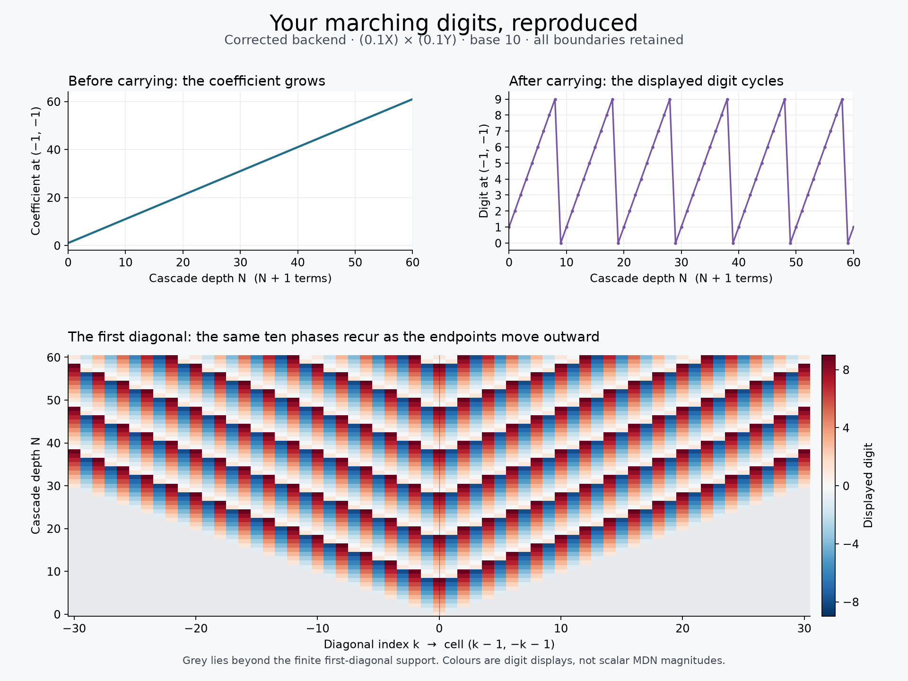

# Infinite decimals with the cascade boundary retained

**We can define infinite decimal inputs, keep X and Y distinct, and do exact
addition and multiplication without identifying 0 with 1.** The construction
keeps the complete rule for the growing cascade. It does not pretend that a
digit cycling forever eventually settles on one value.

This extends [the earlier boundary model](../fuzzy/BOUNDARY.md). The proofs
below concern a specified mathematical construction compatible with the
finite carry rule and checked against the corrected backend. They do not
establish a unique interpretation of every possible infinite grid.

## The marching digits have an exact explanation

For the matched product `F_N = (0.1X)_N × (0.1Y)_N`, let `N` be the app's
cascade depth. There are `n=N+1` terms: depth 20 means 21 terms.

Before carrying, the coefficient at the central mixed cell `(-1,-1)` is
exactly `n`. After carrying, the tested backend display puts `n modulo 10`
there. It therefore cycles:

```text
Depth:          0  1  2  3  4  5  6  7  8  9 10 11 ...
Central digit:  1  2  3  4  5  6  7  8  9  0  1  2 ...
```



There is an explicit two-diagonal carry construction for every depth.
Within any fixed window, increasing the depth by ten eventually repeats
the complete display. Thus we obtain **ten infinite display patterns** by
following the ten possible depth phases separately.

Within this family, fixing the central digit selects the entire infinite
pattern. This is the precise version of the observation that one digit
makes the rest “snap into place.” It does not determine arbitrary MDNs or
the finite depth of a displayed example.

For instance, depths 20 and 30 both have central digit 1. Their displays
agree in the window `max(|x|,|y|) ≤ 21`. At `(-22,21)` they differ: the
digits are 0 and -1. Their complete finite numbers are unequal under the
carry rule.

The [display proof](DISPLAY_PATTERNS.md) proves the construction and the ten
phase limits. It also explains why the infinite picture alone is insufficient
for multiplication: its naive square would require adding infinitely many
positive digit squares at one cell. The finite calculation and its boundary
recipe supply information that this picture has lost.

## There are two different things to extend to infinity

1. **The input decimal:** `0.3`, `0.33`, `0.333`, and so on. Here we construct
   a genuine limit of decimal prefixes.
2. **The cascade depth:** more and more terms generated from each input
   digit. Here we retain the complete dependence on the depth, including
   the moving boundary. We do not replace it with a nonexistent ordinary
   limit of the cycling digits.

An infinite MDN in this construction is an exact, unending recipe with
well-defined arithmetic. Particular display phases can be extracted from
it, but a phase is not the complete number.

The key proof uses a new bookkeeping coordinate, `z = 1/X`. The carry
relation then determines `Y = b − 1/z`. Neither axis receives an ordinary
numerical magnitude. We express each cascade as a power series in `z`,
whose coefficients are exact polynomials in the term count `n`.

The crucial property is simple:

> Coefficient number m depends only on the first m input decimal digits.

Once those digits have been supplied, later digits cannot change that
coefficient. This proves convergence of the decimal prefixes. Addition
and multiplication also require only finitely many contributions to each
coefficient, so they remain defined for infinite inputs and mixed products.

The [formal proof](FORMAL_PROOFS.md) shows that the finite carry algebra and
the earlier boundary expressions embed without losing distinctions. It
also proves that this series algebra has no zero divisors; in particular,
`0` and `1` are different. Swapping X and Y is reversible and preserves
arithmetic, so choosing this bookkeeping coordinate has not merged them.

This choice of convergence has limits. It preserves the finite carry
classes and the earlier regular cascade-boundary families, not every
possible family involving two independently moving cutoffs. Section 8 of
the formal proof gives an explicit example of information it forgets.

## An actual infinite decimal, including its boundary

For repeated digit `a` in base `b`, the infinite X decimal has the exact
expression

\[
0.\overline a_X
=\frac{a}{b-1}(1-B_X),
\qquad B_X=\left(\frac{-Y}{X-1}\right)^n.
\]

`B_X` is the retained boundary expression. The power `n` means the complete
cascade-count recipe, not that an ordinary value has been assigned to
“infinity.” At every finite count, this formula is the exact limit as the
number of repeated input digits grows.

In decimal base, three copies of the `0.333…X` state therefore give
`1 − B_X`. The Y expression is obtained by exchanging X and Y and keeps
its own boundary.

Likewise, the input recipe `0.999…X` gives `1 − B_X`, which is different
from the integer state `1`. This does not dispute the ordinary real-number
identity `0.999… = 1`. It says that the MDN state records extra information.
An ordinary one-axis real interpretation can read these labels in the usual
way, but that interpretation does not extend to the whole mixed algebra
while preserving all its operations and distinctions.

This is a necessary change to the earlier hope that either axis, with all
its boundary information intact, would obey exactly the ordinary real
field operations. Already `0.9X + 0.1X = 1 − E`, with `E` the tenth's
boundary. Declaring an invertible boundary to be zero would give `1 = 0`.
Our construction never makes that identification.

Every ordinary real still has a distinct encoding in either direction:
use its signed magnitude, integer part, and canonical decimal expansion
(trailing zeros for terminating decimals, excluding alternate all-9 tails).
This includes irrational digit streams. It is an encoding of real numbers,
not a claim that arithmetic on their labels always gives the same MDN state.

## Additive X/Y mixing remains distinguishable

For base 10, with the cascade-count rule specified, a constant plus an X
fractional stream plus a Y fractional stream has a unique such
decomposition. Thus the two fractional channels cannot secretly cancel
one another or jointly become an integer through addition.

This result applies to arbitrary bounded digit streams, including infinite
nonrepeating ones. The [analytic proof](../../pitfalls/decimal_infinite/ANALYTIC_PROOFS.md), Section 5,
establishes it for all bases greater than 2. Base 2 has an explicit
exception and is not included in this separation claim.

Multiplication is defined in the larger series algebra. A product need not
be expressible as just another X stream plus another Y stream; that is
where the mixed family becomes necessary.

The analytic proof also supplies ordinary calculus convergence and explicit
error bounds for the infinite decimal prefixes at fixed cascade counts.
These are functions retaining the axis information, rather than one chosen
scalar “magnitude.” It separately states conditions under which a single
axis has an ordinary scalar cascade limit.

## What was tested

All checks used the existing corrected `build/fraxis/libmdn.so`, with base
10, Positive display policy, and unlimited precision. The backend was not
edited or rebuilt for this study.

| Check | Result |
|---|---|
| Mixed tenths, depths 0 through 120 | 121 complete backend displays matched the two-layer formula |
| Decimal prefixes on both axes | 120 complete grids matched independent exact carry calculations |
| Independent formal-series comparison | 3,133 coefficients from those 241 grids agreed exactly, through order 12 |
| Formal-series unit tests | 8 tests passed, covering prefix stability, boundary inverses, axis exchange, and products |

The prefix cases use `0.333…`, `0.142857142857…`, and `√2 − 1`, with 4, 8,
16, and 32 input digits at term counts 1, 3, 6, 11, and 21. The irrational
prefixes come from exact integer square roots. Additional rational
projections check the analytic formulas and their error bounds; those
projections are diagnostics, not a definition of MDN magnitude.

Finite tests support the formulas and implementation. The proofs, rather
than an extrapolation of the tests, establish the stated infinite results.

## Code and reproduction

- [series.py](series.py) implements exact finite portions of the new series.
  It retains symbolic `n`; the current API uses a shared count for both
  axes. Separate count variables are covered mathematically, not yet by
  this prototype API.
- [test_series.py](test_series.py) checks the formal operations.
- [backend_check.py](backend_check.py) compiles a small probe against the
  existing library and regenerates the native grids and
  [backend results](backend_results.json).
- [series_check.py](series_check.py) independently expands those saved grids
  and writes the [coefficient comparison results](series_results.json).
- [make_figure.py](make_figure.py) regenerates the figure above.

From the repository root:

```bash
python3 -m unittest discover -s research/decimal_infinite -p 'test_*.py'
python3 research/decimal_infinite/backend_check.py
python3 research/decimal_infinite/series_check.py
python3 research/decimal_infinite/make_figure.py
```

The probe compilation is logged to the session's home-directory build log.
Full native grids are regenerable and stored in the temporary directory
recorded in `backend_results.json`; compact results and provenance are
kept here. `make_figure.py` requires Matplotlib and NumPy. The series and
verification code otherwise uses the Python standard library.

`SeriesPrefix` deliberately compares only the coefficients actually known.
Agreement through a finite order is not reported as equality of complete
infinite numbers.
