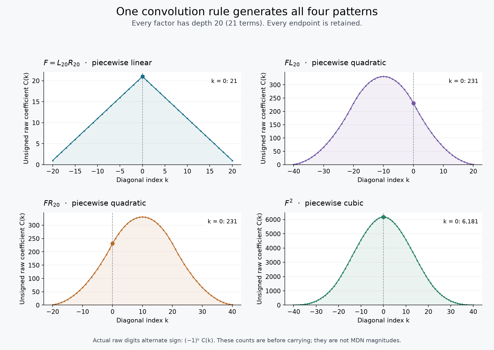

# Boundary-retaining fuzzy MDN families

This study defines the finite family `F(N,M)` and investigates multiplication
by either directional tenth and by another member of the family. It follows
the saved `forAstra.mdnproj` experiment and the earlier
[infinite-expansion analysis](../../pitfalls/infinite/README.md).

Follow-up: [keeping the boundary as part of an infinite MDN](BOUNDARY.md)
explains the carry notation in plain language and defines an extension using
complete refinement recipes. It also examines additive mixing and why freshly
entered decimal fractions need not equal products of shorter entries.

**There is a compact, exact description of these products.**

- All raw products belong to one parameterized family of alternating,
  piecewise-polynomial coefficient patterns. Multiplication concatenates the
  lists of cascade depths.
- Every endpoint is retained in an exact boundary expression. Equal depths,
  unequal depths, and different rates of increasing depth remain distinguishable.
- At matching depths, every expression generated by the two directional
  tenths has a unique form **`A(F) + B(F)L`**, with integer-coefficient
  polynomials `A,B`. Multiplication closes in these two components.
- This is a finite generator description, not a finite basis over numerical
  constants. The powers `1,F,F²,...` remain independent. No relation like
  `i²=-1` has been imposed.

The proofs concern formal grid operations and carry equivalence. They assign
no ordinary real magnitude to either axis. They establish a coherent family
of finite objects, not a cutoff-independent infinite mixed product or a
claim of novelty in the mathematical literature.

## 1. Definitions: what the objects and equality mean

Let the base `b` be an integer at least 2. Decimal examples use `b=10`.
`X` and `Y` denote invertible formal shifts of a grid digit. The raw finite
grid is a Laurent polynomial with integer coefficients. A carry preserves
the relation

\[
X+Y=b.
\]

Two finite grids are **carry-equivalent** if their difference is a finite
integer combination of translated carry relations. This is the algebra

\[
\mathcal A_b=\mathbb Z[X^{\pm1},Y^{\pm1}]/(X+Y-b).
\]

This definition does not presume a unique digit display. The backend has
polymorphic displays; two normalized-looking grids can still be equal here.
Nor does it assert that the GUI's restricted cleanup steps find every possible
equivalence. The independent checker tests the full finite carry relation.

Define

\[
\begin{aligned}
L_N&=\sum_{i=0}^{N}(-1)^iX^{-i-1}Y^i,\\
R_M&=\sum_{j=0}^{M}(-1)^jX^jY^{-j-1},\\
\boxed{F(N,M)&=L_NR_M.}
\end{aligned}
\]

`N,M` are nonnegative cascade settings: **depth 20 means 21 terms**, the root
digit and 20 additional cascade terms. `L_N,R_M` are the finite directional
truncations entered as `0.1X,0.1Y` in base `b`.
At finite depth neither is an exact inverse of `b`.

The whole family is the function `(N,M) -> F(N,M)` into `A_b`. Families with
the same index set add and multiply pointwise. Equality of families means
carry equality at **every** allowed index. For an extra independently
truncated factor, enlarge the index set: `F(N,M)L_P` has indices `(N,M,P)`.
Matching two indices is an explicit specialization, not an implicit default.

No boundary deletion, central-window comparison, or limit is included in this
equality. This family algebra has ordinary associative and distributive finite
operations and `1 != 0`. It does not simultaneously declare both directional
approximations exact inverses of `b`.

## 2. Exact boundary information

Put `q=-Y/X`, a signed diagonal shift. This is a formal symbol, not an assigned
scalar weight. Finite telescoping gives

\[
bL_N=1-q^{N+1},\qquad bR_M=1-q^{-M-1}.
\]

The requested products therefore have these exact certificates:

\[
\boxed{b^2F(N,M)=(1-q^{N+1})(1-q^{-M-1})}
\]

\[
\begin{aligned}
b^3F(N,M)L_P
 &= (1-q^{N+1})(1-q^{-M-1})(1-q^{P+1}),\\
b^3F(N,M)R_Q
 &= (1-q^{N+1})(1-q^{-M-1})(1-q^{-Q-1}),\\
b^4F(N,M)^2
 &= (1-q^{N+1})^2(1-q^{-M-1})^2.
\end{aligned}
\]

For a product of two different fuzzy members, use the four endpoint factors
for `N,M,N',M'`. Every boundary parameter is a power of the **same** `q`.
For example, `q^(N+1) q^(-M-1)=q^(N-M)`; it is 1 only at matching depths.
Keeping only separately named endpoints while forgetting these correlations
would lose exactly the interaction seen in the saved GUI experiment.

For a product of `d` directional factors, replace `b^d` by `(X+Y)^d` and the
same identity holds even as a **raw grid**, before taking the carry quotient.
Thus the boundary expression is also independently verifiable without
assigning any scalar values to `X,Y`.

Dividing a certificate by `b^d` is useful rational bookkeeping. Arbitrary
division by `b` is not an operation being added to the original integer-digit
algebra. The corresponding integer grid already exists by the definition
above; the denominator can always be cleared.

## 3. The basic raw patterns

For

\[
P=\prod_{i=1}^{a}L_{N_i}\prod_{j=1}^{c}R_{M_j},\qquad d=a+c,
\]

each raw nonzero cell lies on `x+y=-d`. Its position is
`(k-a,-k-c)`, and its coefficient is `(-1)^k C(k)`, where `C(k)` counts ways
to choose one term from each cascade with

\[
\sum_j m_j-\sum_i n_i=k.
\]

Equivalently, `C(k)` is a convolution of finite rows of ones. That gives a
single rule for all the requested products:

| Product | Raw line | Unsigned coefficient envelope | Coefficient at `k=0`, depth 20 |
|---|---|---|---:|
| `F(N,M)` | `x+y=-2` | Piecewise linear; triangular or trapezoidal | 21 |
| `F(N,M)L_P` | `x+y=-3` | Piecewise quadratic | 231 |
| `F(N,M)R_Q` | `x+y=-3` | Piecewise quadratic | 231 |
| `F(N,M)^2` | `x+y=-4` | Piecewise cubic | 6,181 |

The depth-20 column uses every cutoff equal to 20. Its cells are respectively
`(-1,-1)`, `(-2,-1)`, `(-1,-2)`, and `(-2,-2)`. These are coefficients before
carrying, not scalar magnitudes or the bounded digits shown by the GUI.
Degenerate short cutoffs can lower the stated polynomial degrees.



All higher products remain in the same parameterized family. A product of
`d` directional factors has coefficient degree at most `d-1`, with breakpoints
specified by subset sums of the endpoint lengths. Only one truncated-binomial
kernel is needed at each order; shifted copies and their boundary coefficients
reconstruct the finite envelope. The order is unbounded under repeated
multiplication. [PROOFS.md](PROOFS.md#raw-pattern-theorem) derives the formula.

Changing a factor from `L_M` to `R_M` also has a simple raw-grid description:

\[
R_M=-q^{-M-1}L_M.
\]

It translates the same coefficient envelope, with the raw coefficient sign
multiplied by `(-1)^M`. This
does not equate the two directional numbers; their positions remain part of
the object.

## 4. A two-component multiplication system at matched depths

Fix one common depth `N`, and write `L=L_N`, `R=R_N`, `F=LR`. The boundary
identities imply

\[
\boxed{bF=L+R,\qquad R=bF-L,\qquad L^2=bFL-F.}
\]

Consequently **every integer polynomial expression in `L,R` has exactly one
form**

\[
\boxed{A(F)+B(F)L,\qquad A,B\in\mathbb Z[F].}
\]

Multiplication is explicitly

\[
\boxed{
(A+BL)(C+DL)
=(AC-BDF)+(AD+BC+bFBD)L.
}
\]

The requested products fit immediately:

\[
FL=FL,\qquad FR=bF^2-FL,\qquad F\cdot F=F^2.
\]

Thus the answer to “a small set of basic patterns?” is **yes, as generators
and polynomial components**. The coefficients `A,B` may have arbitrarily high
degree in `F`. There is no faithful finite list of fixed patterns with only
integer or rational coefficients: `1,F,F²,...` are linearly independent over
those constants.

This result retains all boundaries. For instance, with `t=q^(N+1)`,

\[
\begin{aligned}
b^2F &= 2-t-t^{-1},\\
b^3FL &= 3-3t+t^2-t^{-1},\\
b^3FR &= 3-3t^{-1}+t^{-2}-t,\\
b^4F^2 &= 6-4(t+t^{-1})+t^2+t^{-2}.
\end{aligned}
\]

The stationary coefficients 2, 3, and 6 are exact endpoint interactions.
They are not values obtained by legitimately discarding the remaining terms.
For matched products `L^a R^c`, the corresponding stationary coefficient is
`binom(a+c,a)`.

## 5. Unequal cutoffs: what changes

There are three distinct cases:

1. **A fixed unequal pair.** Put `n=N+1`, `m=M+1`, and `g=gcd(n,m)`. The
   algebra generated by `L_N,R_M` equals the algebra generated by
   `L_(g-1),R_(g-1)`. Taking `G=F(g-1,g-1)` gives the same integral
   two-component form `A(G)+B(G)L_(g-1)`. This is an exact integer
   telescoping result, not an approximation or division by `b`.
2. **Keeping the original unequal `F(N,M)` as the anchor.** Over rational
   coefficients, the number of components over `Q[F(N,M)]` is
   `(n+m)/g`. It is 2 for depths 20/20, 43 for 20/21, and 62 for 20/40.
   An analogous finite-component statement over integer coefficients can
   fail. The proof and an explicit obstruction are in [PROOFS.md](PROOFS.md).
3. **The entire independently indexed family.** An identity must hold for
   every `N,M`. Fixed-cutoff compression does not erase those indices. The
   two directional families have no nonzero universal polynomial relation
   over the numerical constants; matching indices introduces the special
   relation used in Section 4. An independently indexed extra factor requires
   its additional cutoff to be retained too.

The gcd result gives a compact description at each fixed pair, but the anchor
can change abruptly with the pair. It does not select a common infinite limit.

## 6. Cutoff paths and the remaining infinite question

For `F` the exact boundary identity is

\[
b^2F(N,M)=1-q^{N+1}-q^{-M-1}+q^{N-M}.
\]

The last term explains why increasing both depths together is insufficient
as a convergence test. Equal depths keep it at 1; a fixed depth difference
keeps it at a fixed shifted cell; a growing difference moves it away.

The phenomenon persists through all orders. If positive term counts grow as
`t+u_i` on X and `t+v_j` on Y, the ledger terms that remain in a fixed
exponent window are

\[
\sum_{|I|=|J|} q^{\sum_{i\in I}u_i-\sum_{j\in J}v_j}.
\]

Different growth rates give more general subset-sum coincidences, including
cancellation of the stationary term. The full product still contains its
moving endpoints. This window observation is not the equality relation and
is not a value limit in the family algebra.

The completed construction therefore keeps the familiar finite laws and
distinguishes the directional families, with `bL_N=1-q^(N+1)` rather than
`bL=1`. It avoids `0=1` by making no incompatible boundary identifications.
Defining an infinite fuzzy value requires a further explicit choice about
which boundary information is retained, identified, or observed. This study
does not make that choice silently.

## 7. Implementation, checks, and GUI examples

- [family.py](family.py): exact finite-product model, raw patterns, boundary
  expressions, carry equality, matched two-component multiplication, and
  symbolic affine-cutoff ledgers. Its `equals()` compares **finite members**
  at supplied cutoffs; it does not decide all universally quantified family
  identities. Those are established by the proofs.
- [test_family.py](test_family.py): 16 test groups using direct digit-tuple
  enumeration, raw convolution, finite differences, and independent exact
  polynomial checks. They include the integer gcd construction.
- [experiments.py](experiments.py), [results.json](results.json): reproducible
  pattern, boundary, depth-growth, and cutoff-path examples, with figures.
- [backend_probe.cpp](backend_probe.cpp), [backend_check.py](backend_check.py),
  [backend_results.json](backend_results.json): **2,318 exact checks in 122
  cases**, all passing with the corrected `build/fraxis/libmdn.so`.

The backend sweep covers independent small cutoffs, bases 2/3/10/16, every
sign policy, and larger decimal cases through `(N,M,P,Q)=(40,80,40,80)`.
It checks each requested product, the boundary certificates, and alternative
multiplication groupings. Equality is verified coefficient by coefficient
after the formal substitution `Y=b-X`, not by scalar sampling.

**15 alternative groupings produced different raw displays but equal carry
classes.** A GUI resemblance or difference is therefore useful evidence about
representations, but not a complete equality test.

The generated GUI project is
`/home/d.gaden/GADEN/MDN/fuzzy-family-examples.mdnproj`. It contains matching
depth-20 and unequal depth-20/21 products, alternate square displays, and the
integer-scaled boundary expressions. Every saved cell and setting passed an
independent decoder and the native library's project loader; the
[validation record](project_validation.json) includes the tab guide.
[export_project.py](export_project.py)
recreates it from the backend's full grid outputs. Tab names record the input
depths; changing the project's default depth does not regenerate saved grids.

From the repository root:

```bash
python3 -m unittest discover -s research/fuzzy -p 'test_family.py' -v
python3 research/fuzzy/experiments.py
python3 research/fuzzy/backend_check.py
```

The pure model uses only Python's standard library. Figure generation uses
Matplotlib. The backend checker compiles a small probe, dynamically links the
existing corrected library, and logs compiler output to the session's home
log. Its result includes the library hash and dynamic-linkage provenance.
It does not rebuild the library or require the GUI to be installed.
